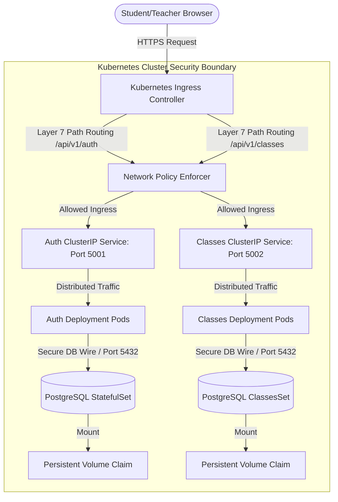

# 🏫 School Portal Monorepo

## 📝 Project Overview
The **School Portal Monorepo** houses a decoupled, production-ready microservices architecture tailored for robust academic and user management infrastructure. By separating domain logic into isolated, containerized application runtimes, the system achieves maximum fault isolation, ultra-fast localized processing, and independent horizontal scalability. 

This ecosystem is engineered for strict enterprise resiliency, ensuring zero-downtime financial and classroom transactions even under volatile, high-concurrency traffic conditions typical during academic enrollment or grading seasons.

---

## 🏗️ Architecture Overview
The platform follows a headless, decoupled cloud-native topology. Traffic transitions from edge distribution directly into a secured, multi-layered cluster environment:

### End-to-End Enterprise Request Lifecycle:
1. **Edge Entry & Reverse Proxying:** Public browser traffic strikes the **Kubernetes Ingress Controller** over HTTPS. The Ingress acts as the frontline shield, managing SSL/TLS decryption and stripping malicious headers.
2. **Layer 7 Routing:** The Ingress inspects request path definitions. Traffic hitting `/api/v1/auth` is cleanly routed toward the `auth-service`, while `/api/v1/classes` is mapped to the `classes-service`.
3. **Network Isolation Enforcement:** Before reaching application workloads, traffic passes through rigid **Network Policies**. These security guardrails restrict cross-pod communication, ensuring only authorized frontend components can interface with application pods, and absolutely no public internet traffic can ever speak directly to internal databases.
4. **Internal Load Balancing:** Kubernetes **Services (ClusterIP)** catch the routed traffic and spread connections evenly across individual service **Pods** using internal cluster routing mechanisms.
5. **Data Orchestration & Persistence:** Application processes access underlying transactional engines via isolated backend streams. Stateful data is dispatched directly to dedicated database engines running as **StatefulSets**, with physical operations committed to raw cloud blocks via **Persistent Volume Claims (PVC)**.

---

## 💻 Tech Stack & Components
*   **Backend Runaway Core:** Python 3.12 powered by the lightweight **Flask API** framework.
*   **Production Gateway Multiplier:** **Gunicorn** (WSGI process execution wrapper allocating worker execution nodes directly proportional to available worker CPU capacities).
*   **Persistent Storage Engines:** **PostgreSQL 15+** instances bound securely inside hidden private network spaces operating on default port `5432`.
*   **Ecosystem Packages Directory:** Tracked and locked cleanly via microservice-specific `requirements.txt` manifests (`psycopg2-binary`, `Flask`, `gunicorn`).

---

## ⚙️ Pattern Implementation & Deployment Strategies

### 🛠️ Kubernetes Declarative Manifest Architecture
The application infrastructure is deployed deterministically via a complete matrix of cloud-native manifests:

*   **Deployments:** Manages the stateless application runtimes for `auth-service` and `classes-service`, declaring explicit image tags, scaling boundaries, and container lifecycles.
*   **Services:** Provides immutable, internal **ClusterIP** endpoints, serving as the localized abstraction layer for pod-to-pod and gateway communications.
*   **StatefulSets & Persistent Volume Claims (PVC):** Utilized exclusively for the database engine layer. Unlike standard stateless deployments, **StatefulSets** provide deterministic network identifiers and stable host naming conventions. Each database node mounts raw, persistent block storage dynamically through **PVCs**, ensuring total historical integrity across data node crashes or automated maintenance recycles.
*   **ConfigMaps & Secrets Configuration Pattern:** Complete environment decoupling is enforced across all repositories. Non-sensitive targets (`DB_HOST`, `DB_PORT`, `DB_NAME`, `DB_USER`) are mapped inside **ConfigMaps**, while sensitive access strings (`DB_PASSWORD`) are stored in base64-encoded **Secrets**.
*   **Dynamic `env` Block Injections:** Pod manifests feature explicit `envFrom` and `valueFrom` references. These hooks catch ConfigMap/Secret values and bind them directly into Python's `os.environ` slots at initial runtime initialization.
*   **Network Policies:** Acts as a pod-level firewall, controlling ingress traffic filters and egress routing parameters to block unauthorized internal cluster cross-talk.
*   **Ingress Rules:** Maps Layer 7 routing blueprints, handling custom host subdomains and pointing them to target internal ClusterIP services cleanly.

### 🛡️ High-Availability, Scaling & Cluster Resiliency Policies
To prevent single points of failure and guarantee performance under load, the deployment models incorporate rigorous platform policies:

*   **Pod Anti-Affinity Scheduling Configuration:** To protect against localized infrastructure node outages, pod specs enforce strict **Pod Anti-Affinity rules** (`topologyKey: "kubernetes.io/hostname"`). This strictly blocks the Kubernetes scheduler from co-locating identical application replica pods onto the same physical cloud host. If a server node fails, remaining replicas on alternate servers pick up the active traffic instantly.
*   **Pod Disruption Budgets (PDB):** System upgrades can cause node evictions. We implement strict **PDB manifests** (`minAvailable: 50%`), forcing the Kubernetes API to block automated cluster actions if an operation threatens to drop the active online pod count below baseline safety thresholds.
*   **Tuned Scaling Architecture (HPA & Cluster Autoscaler):** Pod resources feature hard-coded boundaries to facilitate seamless elastic growth paths:
    *   **Resource Requests & Limits:** Memory and CPU limits are locked down (`resources.requests` and `resources.limits`). 
    *   **Horizontal Pod Autoscaler (HPA):** Monitors active processing metrics. When average container CPU metrics breach 75%, the HPA replicates matching pods across the node infrastructure immediately.
    *   **Cluster Autoscaler (CA):** If a massive rush forces the HPA to spawn more pods than the available hardware nodes can handle, the **Cluster Autoscaler** intercepts the pending pod flags and automatically triggers the underlying cloud platform to provision brand-new physical virtual machine servers to join the cluster capacity pool.
*   **Comprehensive Health Diagnostics Lifecycle (Probes):** Containers utilize a multi-tier automated diagnostic model to ensure traffic never hits broken endpoints:
    *   **Startup Probes:** Holds off all secondary health tracking until heavy initial app environments finish bootstrapping.
    *   **Readiness Probes:** Verifies database accessibility hooks are green before signaling the Service to include the container inside active user routing pools.
    *   **Liveness Probes:** Continually monitors internal system loops. If an unhandled thread locks up Gunicorn, the probe fails and prompts Kubernetes to kill and reboot the pod instantly.

### 🔄 Zero-Downtime Rolling Update Strategy
Application upgrades utilize an automated **Rolling Update Strategy** (`type: RollingUpdate`):
*   **MaxSurge / MaxUnavailable Tuning:** Configured to incrementally roll out new containers (Pod v2) alongside working targets (Pod v1) one by one, ensuring zero resource drops.
*   **Traffic Transition:** The service layer restricts traffic routing from hitting Pod v2 until its **Readiness Probe** reports a 100% healthy status.
*   **Graceful Clean Shutdown:** Once Pod v2 is fully handling user sessions, older containers finish processing remaining active requests before receiving a graceful termination signal, guaranteeing zero user disconnects.
